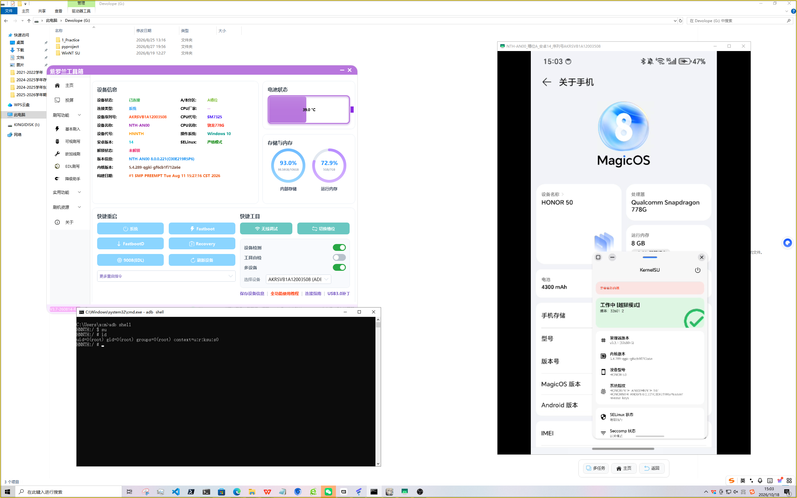

<div align="center">

# HONOR 50（NTH-AN00）KernelSU 晚加载一键提权

**GhostLock / FNE 内核漏洞链 → 常驻 root 通道 → ksud insmod 晚加载 KernelSU**

[-1F3864?style=for-the-badge)]()
[]()
[]()
[]()

**实测结果：`uid=0(root)`，SELinux 保持 `Enforcing`，内核模块 `Live`**

</div>

---

## 这是什么

这是一份**完整、可复现**的 HONOR 50（NTH-AN00）提权记录与工具集。

该机型是 `user` 版固件、`ro.debuggable=0`，`adb root` / `adb remount` / `setprop` 这类常规手段全部无效。本仓库走的是**内核态漏洞利用**路线，并在利用成功后把权限交给 **KernelSU** 托管，最终得到一个标准、稳定、可长期使用的 root 环境。

**一个 CMD 脚本，双击即用。**

```
scripts\root_honor50.cmd
```

---

## 效果



> 右侧手机「关于手机」页面显示 **KernelSU 工作中**；左下 cmd 窗口的 `adb shell` 提权结果为
> `uid=0(root) gid=0(root) groups=0(root) context=u:r:ksu:s0`。

实测验证结果（全部来自设备真实输出）：

| 验证项 | 结果 |
|---|---|
| `adb shell` 原始身份 | `uid=2000(shell)`，`u:r:shell:s0`（未被改动） |
| `su -c id` | `uid=0(root)`，返回码 `0` |
| 提权后 SELinux 域 | `u:r:ksu:s0`（KernelSU 专属域） |
| 内核模块 | `kernelsu 196608 1 - Live 0xffffffd0e49b3000 (OE)` |
| 全局 SELinux | **`Enforcing`** —— 已切回强制模式，root 依旧可用 |
| root 写测试 | `/data/local/tmp/roottest/proof.txt` 写入成功，属主 `root:root` |

其中「**SELinux 已恢复 Enforcing 而 root 依然成立**」是最关键的一条：它说明 root 不是靠 Permissive 模式漏出来的，而是由已加载的内核模块在策略允许下正式提供的。

---

## 适用机型

| 项目 | 实测值 |
|---|---|
| 机型 | **HONOR 50（NTH-AN00）**，device 代号 `HNNTH` |
| Android | 14（SDK 34） |
| 系统版本 | `NTH-AN00 8.0.0.221(C00E219R5P6)` |
| Build 指纹 | `HONOR/NTH-AN00/HNNTH:14/HONORNTH-AN00/8.0.0.221C00E219R5P6:user/release-keys` |
| 内核 | `Linux 5.4.289-qgki-gf6cb1f712a6e #1 SMP PREEMPT ... aarch64` |

> ⚠️ 内核漏洞利用**强依赖内核版本与固件版本**。换一个固件版本、换一个机型，符号表与内存布局就完全不同，**大概率不能直接用**。请把它当作「同一机型 + 同一固件」的复现记录。

---

## 快速开始

### 0. 准备

- Windows 电脑 + 一根能传数据的数据线
- 手机开启「USB 调试」，连接后手机上点「允许」
- 电脑上有 `adb`（Android Platform Tools）。脚本会自动在 PATH、`%LOCALAPPDATA%\Android\Sdk\platform-tools`、`C:\platform-tools` 等位置查找

### 1. 运行

```
双击 scripts\root_honor50.cmd
```

脚本会自动完成：

1. 定位 `adb`、检测设备与机型
2. **检查是否已经 root** —— 是则直接跳到验证，不会重复触发漏洞
3. 推送工具链与脚本到 `/data/local/tmp/ksu_fne/`
4. 触发 GhostLock / FNE 内核漏洞利用
5. 等待常驻 root shell 通道建立
6. 通过通道执行 `ksud insmod` 晚加载 KernelSU
7. 把 SELinux 切回 `Enforcing`，然后逐项验证并打印结果

### 2. 之后怎么用

```cmd
adb shell su -c "id"
adb shell su -c "命令"
```

---

## 仓库结构

```
HONOR50-KernelSU-Root/
├── README.md
├── docs/
│   ├── HONOR50-KernelSU晚加载提权实现记录.docx   # 完整实现记录（含全部脚本源码）
│   └── images/
│       └── root-success.png                       # 提权成功现场截图
├── scripts/
│   ├── root_honor50.cmd                           # ★ Windows 一键提权主脚本
│   └── device/
│       ├── fne_local.sh                           # 漏洞利用驱动（来自 fneroot 应用 assets）
│       ├── chain_hook.sh                          # root 钩子 + 常驻通道改造
│       ├── ksu_lateload.sh                        # 经 root 通道执行的 KernelSU 晚加载
│       └── restore_enforce.sh                     # 最后一步：切回 Enforcing
└── tools/
    ├── e                                          # GhostLock / FNE 漏洞利用二进制
    ├── fne_syms.txt                               # 静态内核符号表
    ├── kernelsu.ko                                # KernelSU 内核模块
    ├── ksud                                       # KernelSU 用户态工具 3.3.0
    ├── magiskpolicy                               # SELinux 策略注入工具
    └── ksu_rules                                  # KernelSU 所需的 SELinux 规则
```

---

## 原理简述

整条链分四个阶段，每个阶段解决一个具体障碍，缺一不可。

### S1 · GhostLock / FNE 内核漏洞利用

利用内核 `pi_waiters` 相关的重入缺陷，通过竞态触发内核内存破坏，在 `u:r:kernel:s0` 上下文中取得 `uid=0`。工作在内核域带来两个决定性好处：

- 天然绕过 SELinux —— 内核域不受普通域策略约束，可直接写 `/proc/sys` 等敏感节点
- 可直接关闭内核模块签名校验（`sig_enforce`），为后续 `insmod` 自定义模块铺路

> ⚠️ 这是内存破坏型利用，**具有概率性**：失败时表现为内核 oops → panic 重启。这属于该利用的已知特性，不是操作失误。

### S2 · 注入常驻 root 通道

漏洞进程的 `uid=0` 上下文是**瞬态**的 —— 链的最后一步会把 SELinux 切回 Enforcing，而这一步会杀掉所有 `kernel:s0` 进程，包括利用进程自己。

所以必须在它死之前把权限搬运出去。`chain_hook.sh` 在被拉起后立刻建立一条 FIFO 通道：

```sh
rm -f /data/local/tmp/rs.in /data/local/tmp/rs.out
mkfifo /data/local/tmp/rs.in
chmod 666 /data/local/tmp/rs.in
: > /data/local/tmp/rs.out
chmod 666 /data/local/tmp/rs.out
setsid /system/bin/sh -c 'while true; do /system/bin/sh </data/local/tmp/rs.in \
       >>/data/local/tmp/rs.out 2>&1; done' </dev/null >/dev/null 2>&1 &
```

`setsid` 让 shell 脱离控制终端并常驻；`666` 权限让普通 `adb shell`（uid=2000）也能写入 `rs.in`、读取 `rs.out`，形成一问一答的持久 root 会话。同时趁 root 身份把 `/proc/kallsyms` 全量导出（实测 300873 行）。

### S3 · KernelSU 晚加载

**关键决策：不用手工 `load_ko`，改用官方 `ksud insmod`。**

设备预置了 `load_ko`（配合 fake kallsyms 做符号解析），但这条路在本机被证明走不通：

- `fne_syms.txt` 是随 APK 附带的**静态**符号表，而 KASLR 每次开机都重新随机化
- 实测约 **57154 个符号与真实地址差 `0x30`**，约 **41699 个差 `0x180`**
- 更致命的是，厂商已把 `commit_creds` / `prepare_kernel_cred` 从 kallsyms 中**过滤**掉，手工补出的地址是错的，模块 init 一跳就飞 → panic

而官方 `ksud`（3.3.0）的 `insmod` 子命令**内置运行时符号解析与重定位**，不需要任何手工地址表。

加载前必须在 root 通道里完成三件事：

1. 清零 `panic_on_oops` —— 让 insmod 期间的任何 oops 变成可观察日志，而不是直接重启
2. 快照原始 SELinux 策略（实测 1612459 字节），作为模块的 `pristine_policy` 参数
3. 用 `magiskpolicy --apply ksu_rules --live` 先注入 ksu 域所需的规则（late-load 不会自己应用规则）

然后：

```sh
$D/ksud insmod $D/kernelsu.ko "allow_shell=1 pristine_policy=$D/pristine_policy"
```

模块加载后会自动认领管理器应用 `me.weishu.kernelsu`，依次执行 `post-fs-data` / `services` / `boot-completed` 三个阶段，并安装标准 su 入口 `/system/bin/su`。

### S4 · 收尾

把 SELinux 切回 `Enforcing`，确认 root 依然可用。

---

## 踩过的坑

这部分几乎是整份记录里最有价值的内容 —— 失败点全部集中在「符号与行尾」这类不起眼的地方。

| 现象 | 根因 | 修复 |
|---|---|---|
| `load_ko` 报告 `resolved 0/184`，grep 无匹配 | Windows 侧用 PowerShell `WriteAllLines` 生成 fake kallsyms，默认 CRLF 行尾，符号名尾部带了 `\r`，内核加载器按精确字符串匹配全部落空 | 改用 `WriteAllText` 并手动拼接 `` `n ``，强制 LF |
| 补全符号后部分仍解析不到 | kallsyms 是有序表，加载器依赖顺序；把缺失符号追加到**文件末尾**破坏了有序性 | 改为按地址升序**插入到正确位置** |
| 符号解析 `184/184` 但模块 init 阶段 panic | 静态符号表与运行内核地址大面积不一致，且厂商过滤了 `commit_creds` 等符号，手工补地址是错的 | 彻底放弃手工地址表，改用官方 `ksud insmod` |
| `chain_hook.sh` 报 `slide mismatch`，`chain_status=slidemismatch` | FNE 每次开机重新随机化（本次实测 slide = `0x10e5800000`），真实与 fake 的 `commit_creds` 恰好差 `0x30` | 该路径主动放弃自动加载，把设备留在 Permissive + 通道可用，交由上层用 ksud 接手 |
| 通过 `adb shell` 执行带 `$(...)` 的命令时命令残缺 | 本地 PowerShell 先做了字符串插值 | 统一改为「本地写 `.sh` → `adb push` → `adb shell sh 执行`」 |
| 中文批处理在 cmd 里显示成乱码 | 控制台代码页与文件编码不匹配 | `.cmd` 存为 **UTF-8 with BOM**，开头执行 `chcp 65001` |
| 想后台启动设备端脚本，结果进程立刻消失 | `adb shell "... &"` 退出时会连带杀掉同会话进程 | 改为前台阻塞执行；root 通道本身用 `setsid` 在设备端脱离会话，不受影响 |

---

## 已知限制

- **重启后需要重新运行。** 本次是 KernelSU 的 **late-load**（晚加载）模式：模块在系统启动完成后才被手动 `insmod`，默认不会在下次开机自动恢复。实测设备内也没有针对 ksu 的 init 触发服务。要持久化，需要用 `/data/adb/ksu/bin/bootctl` 把 LKM 写入 boot 分区 —— 那会修改启动镜像，属于不可逆操作，本仓库未执行。
- **利用是概率性的。** 失败会导致 panic 重启。重启后等手机开机，重新运行脚本即可。
- **强绑定内核版本。** 见上文「适用机型」。

---

## 风险与免责声明

- 内核内存破坏利用失败可能导致 panic 重启，极端情况下可能造成**数据损坏** —— 操作前请务必备份重要数据。
- 把 SELinux 短暂置为 `Permissive` 会打开一个安全窗口，期间系统防护显著下降。
- `kptr_restrict` 被清零后内核地址对用户态可见，属于信息泄露风险。
- 该操作会使设备进入非官方状态，可能导致**保修失效、OTA 升级失败、部分金融类应用拒绝运行**。
- 本仓库中的 `tools/` 二进制来自设备预置的第三方 root 应用（`com.edge.Jinglian.fneroot`）assets，本仓库仅作个人复现记录与备份用途收录。请在**你拥有合法处置权的设备**上使用。

**请仅在你自己的设备上使用。因使用本仓库内容导致的任何后果，由使用者自行承担。**

---

## 详细文档

完整的实现记录（设备信息、四阶段攻击链、5 类踩坑与修复、完整复现步骤、全部脚本源码）见：

📄 **[docs/HONOR50-KernelSU晚加载提权实现记录.docx](docs/HONOR50-KernelSU晚加载提权实现记录.docx)**

---

<div align="center">

实验日期：**2026-10-18**　|　执行方式：**adb（USB）**

</div>
